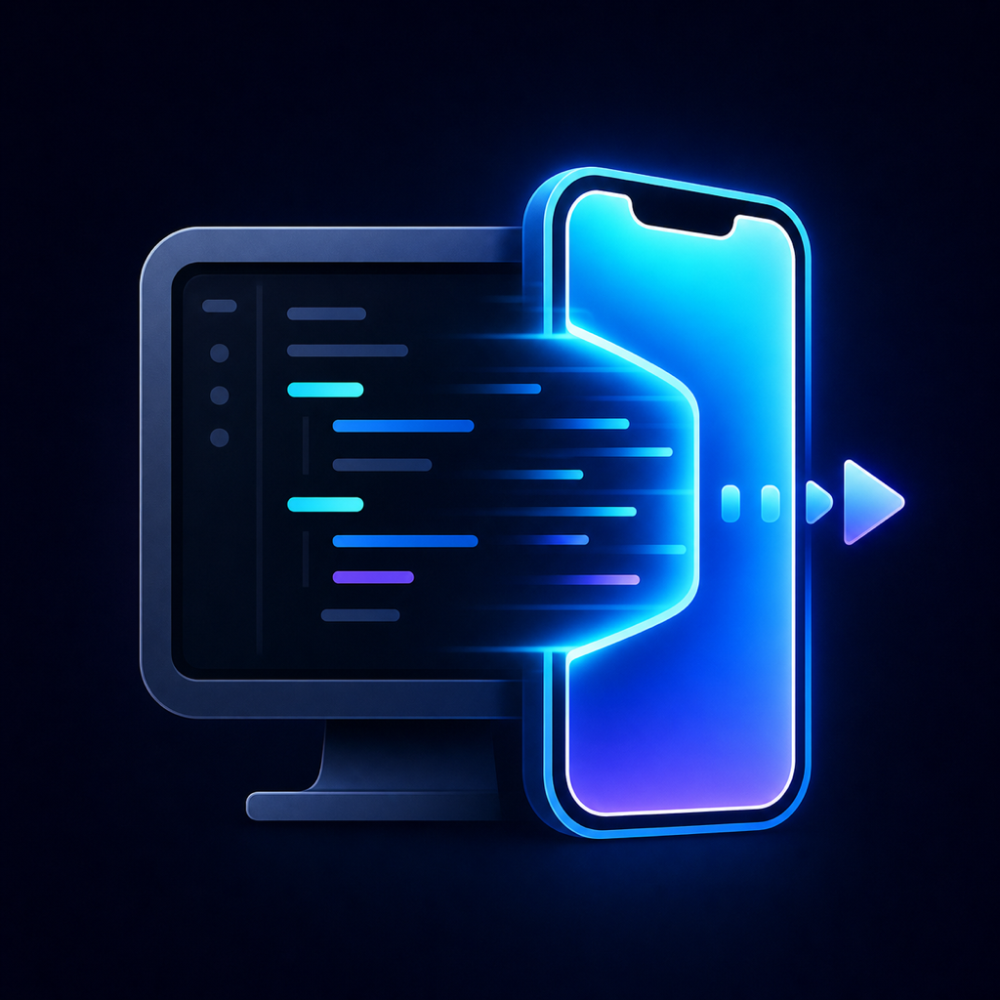

<p align="center"></p>

# Swift Sim

Build iPhone apps with a coding agent on your Mac. Install and test them on your iPhone, even when you are away from the Mac. Compatible Debug edits hot reload; other changes use a signed Xcode build.

Swift Sim is a public beta. Check [Companion availability](docs/TESTFLIGHT.md#availability) before starting.

## Get started

1. Install the Mac tools:

   ```sh
   brew install miguelosaurus/tap/swift-sim
   swift-sim setup
   swift-sim doctor
   ```

2. Install the [iPhone companion](https://testflight.apple.com/join/HMUUFYNK) when a beta build is available. For remote builds and hot reload, connect the Mac and iPhone to the same private Tailscale network.
3. Open your project in a supported coding agent on the Mac and ask: “Set up Swift Sim for this project so I can test changes on my iPhone.”
4. Follow the agent's signing, pairing and Debug installation steps. Then ask for a change and test it on the phone.

Keep the Mac awake and online with the agent running. First-time Apple signing and device trust may require access to the Mac or a trusted device connection. For a first install or when native installation is unavailable, open **Open in Swift Sim to Install** on the iPhone and confirm the iOS installer.

[Setup](docs/SETUP.md) covers requirements and pairing. [Troubleshooting](docs/TROUBLESHOOTING.md) helps with failed steps.

## Make changes

Once phone delivery is set up in the chat, the agent delivers each completed change. Compatible edits can wait on the Mac while the app is offline or in the background. Return to the Debug app to apply them. A glow shows progress from compilation; the new screen appears behind a ripple. SwiftUI bodies, supported helpers and `static let` constant edits can hot reload. Some changes need a signed build instead. See [hot reload](docs/ASYNC_HOT_RELOAD.md) for limits and status.

The companion groups builds by app and keeps build history. **New build** compiles the Mac's current working tree, including uncommitted changes. **Create new install link** republishes a saved build. Neither pulls Git changes or switches branches. See [app library and storage](docs/APP_LIBRARY.md).

## More tools

- [Developer menu](docs/DEVELOPER_MENU.md): inspect the screen, share a problem, and test appearance, text size and right-to-left layout in a Debug app.
- [Activity and notifications](docs/NOTIFICATIONS.md): see builds and changes; background alerts have separate availability requirements.
- **Test with Agent**: opt-in phone testing with explicit session approval.
- **Simulator preview**: view a Mac-hosted Simulator over the private Tailscale network.

## Privacy and requirements

You need an Apple silicon Mac with Xcode, Homebrew and Codex, Cursor, Claude Code or OpenCode; Apple development signing for your iPhone; and a supported iPhone with the Companion beta. Private remote features require Tailscale on both devices. See [Setup](docs/SETUP.md).

Xcode handles Apple signing. Source, builds and compiler inputs stay on the Mac; your coding agent has its own data policy. Private commands and live patches use the Tailnet. Temporary install delivery exposes a token-protected build. See [Security](docs/SECURITY.md) and [Privacy](docs/PRIVACY.md).

## Documentation and contributing

Start with the [documentation guide](docs/README.md), [agent workflows](docs/AGENT_WORKFLOWS.md), [architecture](docs/ARCHITECTURE.md), or [changelog](CHANGELOG.md). For repository work, see [Contributing](CONTRIBUTING.md), [Development](docs/DEVELOPMENT.md), [Releasing](docs/RELEASING.md), and [third-party sources](THIRD_PARTY.md). Follow the [Code of Conduct](CODE_OF_CONDUCT.md) and report vulnerabilities privately via [Security](SECURITY.md).

Swift Sim is open source under the [Apache License 2.0](LICENSE).
