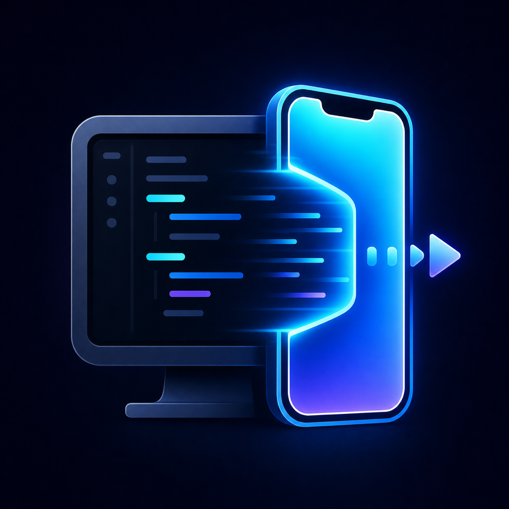

<p align="center">
  
</p>

<h1 align="center">Swift Sim</h1>

<p align="center">
  Build iPhone apps with the coding agent on your Mac. Install and test them on your iPhone from anywhere.
</p>

<p align="center">
  <a href="LICENSE"></a>
  <a href="https://github.com/Miguelosaurus/Swift-Sim/actions/workflows/verify.yml"></a>
  <a href="https://testflight.apple.com/join/HMUUFYNK"></a>
  
  
</p>

Swift Sim connects the coding agent on your Mac to the real app on your iPhone. Ask for a change, let the agent deliver it, and test it on your phone from anywhere. Compatible Debug edits hot reload; changes that need a new binary use a signed Xcode build.

Swift Sim is a public beta. Mac tools and the Debug SDK are available in tagged releases. **Companion beta status, November 8, 2026:** the previous TestFlight builds have expired. A refreshed Companion build must complete distribution before new testers can use the public link. Check [TestFlight availability](docs/TESTFLIGHT.md#availability) before starting.

## Quick Start

1. Install the Mac package:

   ```sh
   brew install miguelosaurus/tap/swift-sim
   swift-sim setup
   swift-sim doctor
   ```

2. Install the current [iPhone companion](https://testflight.apple.com/join/HMUUFYNK) when an active beta build is available. For remote builds and hot reload, install Tailscale on the Mac and iPhone and connect both to the same private Tailnet.
3. Open the project in a supported coding agent on your Mac and ask:

   ```text
   Set up Swift Sim for this project so I can test changes on my iPhone.
   ```

4. Follow the one-time signing, pairing and Debug-install steps returned by the agent. The agent prepares the matching SDK and compiler settings; you do not choose a hot-reload mechanism or operate a separate injection app.
5. Ask for a change and test it in the running Debug app. Once phone delivery is established in that chat, the agent delivers each completed logical change automatically.

Keep the Mac awake, online and running the local agent. Your phone can use cellular or another Wi-Fi network. First-time Apple development signing/device trust is a separate prerequisite; it can require access to the Mac or an initial trusted device connection.

For a first install or a fallback without a reachable private connection, the agent may return **Open in Swift Sim to Install**. Open it on the iPhone and confirm the normal iOS installer. These install links do not require Tailscale.

See [Setup](docs/SETUP.md) for the full requirements and [Troubleshooting](docs/TROUBLESHOOTING.md) for a failed step.

## One Change, The Right Delivery

| Situation | Swift Sim action | What you do on the iPhone |
| --- | --- | --- |
| Compatible edit in a prepared Debug app | Prepare a signed patch; queue it if the app is absent | Return to the app; test after its confirmed refresh |
| Edit needs a full build and Apple's trusted developer connection is reachable | Build, install and launch through Xcode when supported | Follow the returned result; no install link is needed for a verified native install |
| Full build while native installation is unavailable, including cellular | Queue the system install prompt through the matching Debug app when available | Return to that app and confirm Install/Download |
| First install or no matching integrated Debug app | Return a protected install handoff | Open the link and confirm installation |
| Outcome is uncertain | Reconcile the existing request and native receipt | Follow the current status; do not submit the edit again |

The agent chooses the path with `swift-sim deliver-change`. Native installation depends on Apple's developer connection being reachable; Tailscale reachability alone does not make it available. Unlocking alone does not foreground an app or guarantee an installer prompt.

Hot reload requires a development-signed Debug build with SwiftSimLive and matching components. It is excluded from Release, TestFlight and App Store builds of the app being developed. The Swift Sim Companion itself can be distributed through TestFlight. See [hot-reload support and limits](docs/ASYNC_HOT_RELOAD.md).

SwiftUI body edits, supported helpers, new views and bounded State additions have qualified live paths. Other storage, signatures, resources, packages and signing changes require a rebuild. The [evidence index](docs/evidence/README.md) records exercised cases, not a promise that every Swift edit can reload.

## A Small App Library

The companion groups builds under each app, shows icons and the latest update, and keeps previous builds in history. It reports installation only from matching evidence; an opened installer or sent notification is not proof that an update finished.

**Build Current Code** asks the paired Mac to compile the project exactly as it exists, including uncommitted changes. It does not pull Git changes or switch branches. **Create New Install Link** republishes an existing saved build without compiling source.

Generated compiler caches have bounded retention with current live baselines, installed/recent builds and pending work protected. App history is separate from retained build files. See [app library and storage](docs/APP_LIBRARY.md).

## Optional Tools

- **Activity:** builds, queued changes and confirmed results appear in Swift Sim. Background alerts additionally need a configured push sender; ordinary public-beta users should not be asked to provide a signing key for our Companion. See [notification availability](docs/NOTIFICATIONS.md#public-beta-availability).
- **Developer menu:** request scoped Debug context when investigating a problem. It does not upload context automatically.
- **Test with Agent:** a separate, opt-in testing runner with explicit session approval. It is not required for builds, hot reload or notifications.
- **Simulator:** stream a Mac-hosted Simulator through the private Tailnet when a preview is useful. Same Wi-Fi is not required.

## Local-First Boundaries

Xcode owns Apple signing. Project builds, source files and live compiler inputs stay on the Mac; Swift Sim does not upload them to a Swift Sim source or artifact service. Your chosen coding agent has its own data-processing policy.

The full helper listens on localhost. Pairing, remote commands, Debug patches and Simulator controls stay on the private Tailnet. Temporary public install delivery exposes only a token-protected build. Optional Apple push carries bounded notification text and opaque identifiers, not install credentials or source. Read [Security](docs/SECURITY.md) and [Privacy](docs/PRIVACY.md).

## Requirements

- Apple silicon Mac with Xcode, Homebrew and a supported local coding agent: Codex, Cursor, Claude Code or OpenCode
- Apple development signing and a provisioning profile covering the destination iPhone
- iPhone running a supported iOS version with an active Companion beta build
- Tailscale on both devices for private remote features

The Mac must remain awake and online to build or deliver changes. iOS suspension is respected: compatible intent waits on the Mac until the matching Debug app can run. No management profile or unattended native cellular installer is part of the normal workflow.

## Documentation

Start at the [Documentation Guide](docs/README.md).

- [Setup](docs/SETUP.md): install Swift Sim and create the first iPhone build
- [Troubleshooting](docs/TROUBLESHOOTING.md): symptom-based recovery steps
- [Agent Workflows](docs/AGENT_WORKFLOWS.md): Codex, Cursor, Claude Code, and OpenCode behavior
- [Architecture](docs/ARCHITECTURE.md): components, transport paths, and data models
- [Security](docs/SECURITY.md): trust boundaries, tokens, signing, and network exposure
- [Development](docs/DEVELOPMENT.md): contributor workflow and release validation
- [Changelog](CHANGELOG.md): notable changes by release

## Contributing

The repository is the source of truth for the helper, CLI, agent integrations, iPhone companion, and documentation. Changes must keep those layers aligned.

Read [Contributing](CONTRIBUTING.md) for the source map and isolated checks,
[Releasing](docs/RELEASING.md) for publication gates, and
[third-party sources](THIRD_PARTY.md) for dependency provenance. Follow the
[Code of Conduct](CODE_OF_CONDUCT.md); report vulnerabilities privately using
[Security](SECURITY.md).

Read [Contributing](CONTRIBUTING.md) before opening a pull request. Follow the [Code of Conduct](CODE_OF_CONDUCT.md). Report vulnerabilities through the private process in [Security Policy](SECURITY.md).

Swift Sim is open source under the [Apache License 2.0](LICENSE).

Activity updates and optional iPhone alerts cover ready builds, queued edits and
confirmed results. See [notifications setup and proof limits](docs/NOTIFICATIONS.md).
